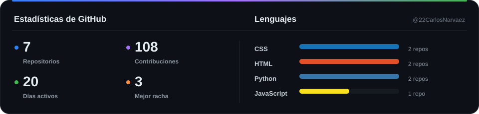
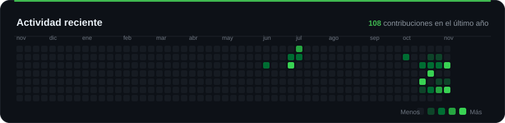
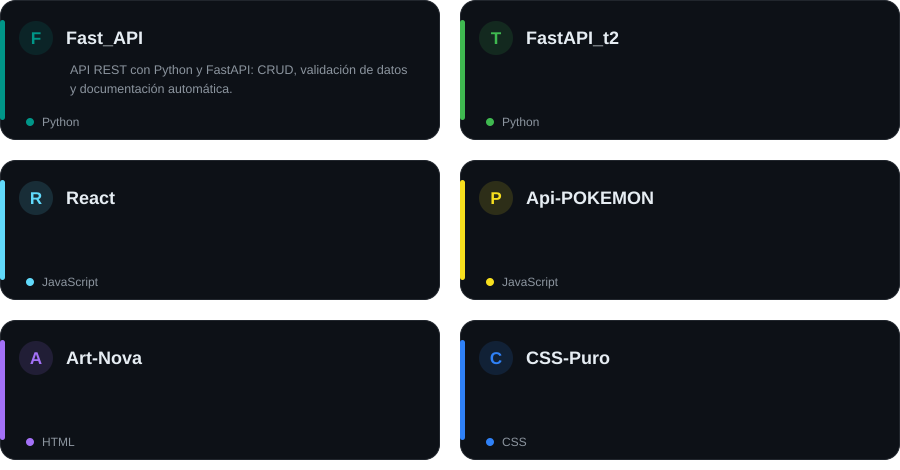

<div align="center">
  
</div>

<div align="center">
  <a href="https://github.com/22CarlosNarvaez">
    
  </a>
</div>

<div align="center">

[**Sobre mí**](#sobre-mí) · [**Lo que hago**](#lo-que-hago) · [**Estadísticas**](#estadísticas) · [**Proyectos**](#proyectos) · [**Contacto**](#contacto)

</div>

---

## Sobre mí

```yaml
nombre:      Carlos Arturo Narváez Zambrano
rol:         Full Stack Developer
enfoque:     APIs con Python/FastAPI + interfaces web modernas
actualmente: Construyendo proyectos reales y mejorando cada día
ubicación:   Medellín, Antioquia, Colombia
```

Desarrollo aplicaciones de punta a punta: desde la **API y la lógica del backend** hasta la **interfaz y la experiencia de usuario**. Me interesa el código limpio, los productos bien pensados y el detalle en el diseño.

**Stack:** `Python` · `FastAPI` · `JavaScript` · `React` · `HTML5` · `CSS3` · `Bootstrap` · `Git` · `Postman`

<details>
<summary><b>🇬🇧 About me (English)</b></summary>

<br/>

```yaml
name:      Carlos Arturo Narváez Zambrano
role:      Full Stack Developer
focus:     Python/FastAPI APIs + modern web interfaces
currently: Building real projects and leveling up every day
location:  Medellín, Antioquia, Colombia
```

I build applications end to end: from the **API and backend logic** to the **interface and user experience**. I care about clean code, well-thought-out products and attention to detail.

</details>

---

## Lo que hago

<table>
  <tr>
    <td align="center" width="33%" valign="top">
      <h3>🎨 Frontend</h3>
      <p>Interfaces modernas, responsive y cuidadas con <b>HTML, CSS, JavaScript y React</b>.</p>
    </td>
    <td align="center" width="33%" valign="top">
      <h3>⚙️ Backend</h3>
      <p>APIs REST con <b>Python y FastAPI</b>: validación, documentación automática y buenas prácticas.</p>
    </td>
    <td align="center" width="33%" valign="top">
      <h3>🧩 Producto</h3>
      <p>Del diseño a la implementación: <b>código limpio</b>, atención al detalle y foco en el usuario.</p>
    </td>
  </tr>
</table>

### Ahora mismo

- 🔭 Construyendo y puliendo proyectos de **backend y frontend**.
- 🌱 Aprendiendo **testing, despliegue y arquitectura** de aplicaciones.
- 🤝 Abierto a **colaborar** en proyectos y a oportunidades laborales.
- ⚡ Frase de cabecera: *"Primero haz que funcione, luego haz que se vea bien."*

---

## Estadísticas

<div align="center">



<br/><br/>



</div>

---

## Proyectos

<div align="center">

<a href="https://github.com/22CarlosNarvaez?tab=repositories">
  
</a>

<br/>

[Fast_API](https://github.com/22CarlosNarvaez/Fast_API) · [FastAPI_t2](https://github.com/22CarlosNarvaez/FastAPI_t2) · [React](https://github.com/22CarlosNarvaez/React) · [Api-POKEMON](https://github.com/22CarlosNarvaez/Api-POKEMON) · [Art-Nova](https://github.com/22CarlosNarvaez/Art-Nova-Exposiciones-Artistas-y-Paneles-con-Bootstrap-5.) · [CSS Puro](https://github.com/22CarlosNarvaez/-CSS-Puro-Modelos-y-Grid.)

</div>

---

## Contacto

<div align="center">

¿Tienes un proyecto en mente o una oportunidad? **Hablemos.**

*Have a project or an opportunity in mind? **Let's talk.***

<br/><br/>

[](mailto:carlosarturon2020@gmail.com)
[](https://github.com/22CarlosNarvaez)

<br/><br/>

<sub>Gracias por visitar mi perfil · Thanks for visiting my profile</sub>

</div>
