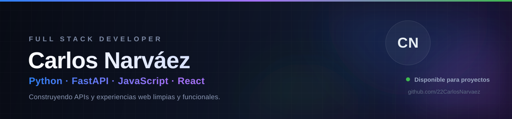

<div align="center">
  
</div>

<div align="center">
  <a href="https://github.com/22CarlosNarvaez">
    
  </a>
</div>

---

## Sobre mí

```yaml
nombre:      Carlos Arturo Narváez Zambrano
rol:         Full Stack Developer
enfoque:     APIs con Python/FastAPI + interfaces web modernas
actualmente: Construyendo proyectos reales y mejorando cada día
ubicación:   Medellín, Antioquia, Colombia
```

Desarrollo aplicaciones de punta a punta: desde la **API y la lógica del backend** hasta la **interfaz y la experiencia de usuario**. Me interesa el código limpio, los productos bien pensados y el detalle en el diseño.

- Trabajo principalmente con **Python, FastAPI, JavaScript y React**.
- Aprendiendo constantemente sobre **testing, despliegue y buenas prácticas**.
- Abierto a **colaborar** en proyectos y a oportunidades laborales.

## About me

```yaml
name:      Carlos Arturo Narváez Zambrano
role:      Full Stack Developer
focus:     Python/FastAPI APIs + modern web interfaces
currently: Building real projects and leveling up every day
location:  Medellín, Antioquia, Colombia
```

I build applications end to end: from the **API and backend logic** to the **interface and user experience**. I care about clean code, well-thought-out products and attention to detail.

- Main stack: **Python, FastAPI, JavaScript and React**.
- Constantly learning about **testing, deployment and best practices**.
- Open to **collaboration** and job opportunities.

---

## Tecnologías

`Python` · `FastAPI` · `JavaScript` · `React` · `HTML5` · `CSS3` · `Bootstrap` · `Git` · `GitHub` · `VS Code` · `Postman`

---

## Estadísticas

<div align="center">


<br/>


</div>

---

## Proyectos destacados

<table>
  <tr>
    <td width="50%" valign="top">
      <h3>⚡ Fast_API</h3>
      <p>API REST con <b>Python y FastAPI</b>: operaciones CRUD, validación de datos y documentación automática con Swagger UI.</p>
      <a href="https://github.com/22CarlosNarvaez/Fast_API"><b>Ver repositorio →</b></a>
    </td>
    <td width="50%" valign="top">
      <h3>🛒 TechGear — FastAPI_t2</h3>
      <p>Tienda de tecnología con <b>API FastAPI</b>, escaparate en Django, catálogo, carrito y seguimiento de pedidos.</p>
      <a href="https://github.com/22CarlosNarvaez/FastAPI_t2"><b>Ver repositorio →</b></a>
    </td>
  </tr>
  <tr>
    <td width="50%" valign="top">
      <h3>⚛️ React — Red Science</h3>
      <p>Aplicación web progresiva (<b>PWA</b>) con React y Vite: rutas, autenticación simulada y tema claro/oscuro.</p>
      <a href="https://github.com/22CarlosNarvaez/React"><b>Ver repositorio →</b></a>
    </td>
    <td width="50%" valign="top">
      <h3>🐉 PokeAPI App</h3>
      <p>Aplicación que consume la <b>PokéAPI</b> con JavaScript puro: búsqueda por nombre o ID y tarjetas dinámicas.</p>
      <a href="https://github.com/22CarlosNarvaez/Api-POKEMON"><b>Ver repositorio →</b></a>
    </td>
  </tr>
  <tr>
    <td width="50%" valign="top">
      <h3>🎨 Art Nova</h3>
      <p>Galería de arte con <b>Bootstrap 5</b>: exposiciones, artistas y paneles diferenciados por rol.</p>
      <a href="https://github.com/22CarlosNarvaez/Art-Nova-Exposiciones-Artistas-y-Paneles-con-Bootstrap-5."><b>Ver repositorio →</b></a>
    </td>
    <td width="50%" valign="top">
      <h3>📐 CSS Puro — Grid</h3>
      <p>Layouts modernos con <b>CSS Grid, Flexbox y modelo de caja</b>, sin frameworks.</p>
      <a href="https://github.com/22CarlosNarvaez/-CSS-Puro-Modelos-y-Grid."><b>Ver repositorio →</b></a>
    </td>
  </tr>
</table>

---

## Contacto

<div align="center">

¿Tienes un proyecto en mente o una oportunidad? **Hablemos.**

*Have a project or an opportunity in mind? **Let's talk.***

**Email:** [carlosarturon2020@gmail.com](mailto:carlosarturon2020@gmail.com)
&nbsp;·&nbsp;
**GitHub:** [@22CarlosNarvaez](https://github.com/22CarlosNarvaez)

<br/><br/>

<sub>Gracias por visitar mi perfil · Thanks for visiting my profile</sub>

</div>
